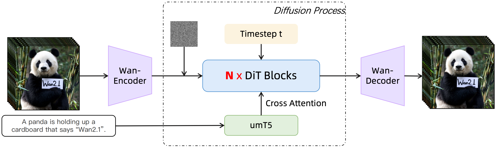
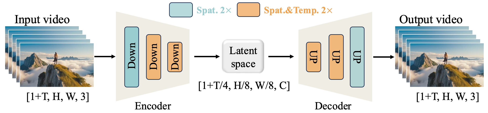
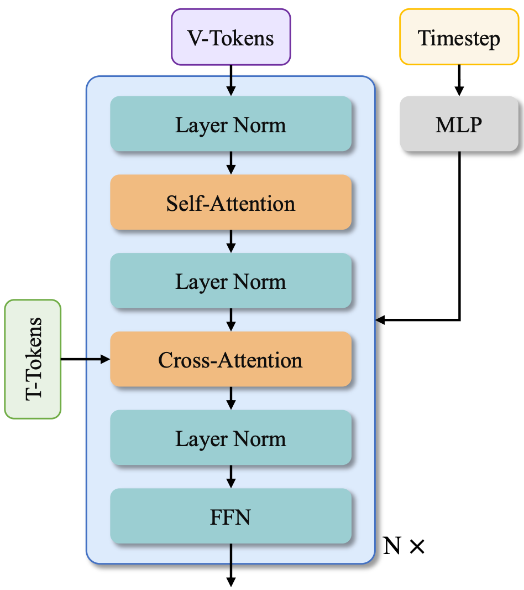
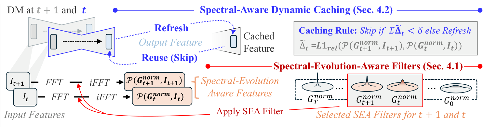
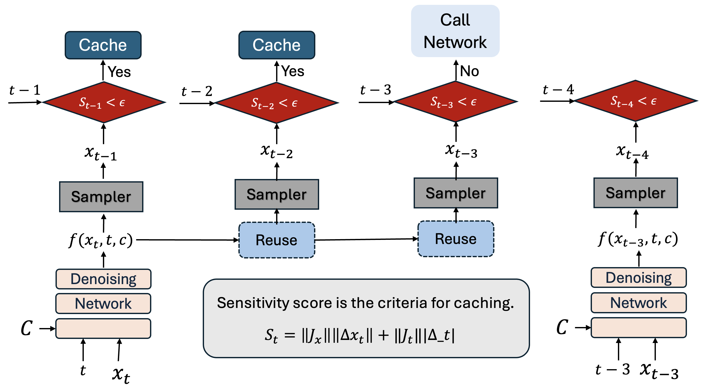
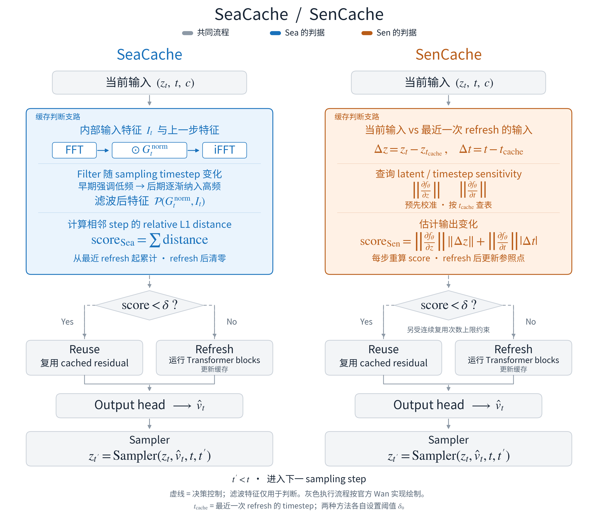

# CE6190-Visual-Generation

- Wan2.1
    
    
    
    - VAE
        
        
        
    - DiT
        
        
        
    - Diffusion
        
        
        |  | training | sampling |
        | --- | --- | --- |
        | input | $z_t=(1-t)z_0+t\epsilon$ | $z_1=\epsilon$ 让 $t$ 递减 |
        | Step 1 | $\hat v_t=f_\theta(z_t,t,c)$ | $\hat v_t=f_\theta(z_t,t,c)$ Adaptive Caching |
        | Step 2 | $\mathcal L=\lVert\hat v-(\epsilon-z_0)\rVert^2$ | $z_{t-T}=\operatorname{Sampler}(z_t,\hat v_t,t,t-T)$ |
        | output | 训练好的 $\theta$ | 生成视频 $\hat z_0$ |
- Adaptive Caching → Efficient Generation
    - skip/reuse or compute/refresh?
    
    |  |  | 任务 |  | backbone | dataset | SeaCache | SenCache |
    | --- | --- | --- | --- | --- | --- | --- | --- |
    | SeaCache | CVPR 2026 Oral | T2I T2V | when | FLUX.1-dev **Wan2.1**-1.3B HunyuanVideo | DrawBench **VBench** |  |  |
    | SenCache | CVPR 2026 Oral | T2V | when | **Wan2.1** CogVideoX LTX-Video | **VBench** T2V-CompBench |  |  |
    | Uncached |  |  |  |  |  |  |  |
    | TeaCache | CVPR 2025 Highlight | T2V | when | Open-Sora Latte | **VBench** T2V-CompBench | 主表 | 主表 |
    | MagCache | NeurIPS 2025 | T2I T2V | when | FLUX **Wan2.1**-1.3B Open-Sora 1.2 HunyuanVideo CogVideoX | **VBench** | 附录 | 主表 |
    | TaylorSeer | ICCV 2025 | T2I T2V C2I | how | FLUX.1-dev HunyuanVideo DiT-XL/2 HiDream FramePack **Wan2.1** | DrawBench **VBench** ImageNet-256 | 主表 | / |
    | Δ-DiT | IJCV 2026 | T2I C2I | which | PixArt-α DiT-XL SD3 | ImageNet MS-COCO2017 PartiPrompts | Table 1 | / |
    | ToCa | ICLR 2025 | T2I T2V C2I | which | PixArt-α OpenSora DiT-XL/2 FLUX | ImageNet-256 **VBench** MS-COCO2017 PartiPrompts | Table 1 | / |
    | DiCache | ICLR 2026 | T2I T2V | when how | FLUX.1-dev **Wan2.1**-1.3B HunyuanVideo | LAION-5B VideoDPO+VideoFeedback 经 GPT-4o 润色 | 消融 | / |
    | D2Cache | CVPR 2026 | T2V | how | **Wan2.1**-1.3B Open-Sora 1.2 LTX-Video Latte | **VBench** | / | / |
    | TC-Padé | CVPR 2026 | T2I T2V C2I | when how | FLUX.1-dev **Wan2.1**-1.3B DiT-XL/2 | ImageNet-256 **VBench**-2.0 COCO2017 | / | / |
    | BWCache | ICLR 2026 | T2V | when which | **Wan2.1** Open-Sora Latte HunyuanVideo | Open-Sora **VBench** T2V-CompBench | / | / |
    | SVD-Cache | CVPR 2026 | T2I T2V | how | FLUX.1-dev HunyuanVideo | DrawBench **VBench** | / | / |
    | WorldCache | ECCV 2026 | T2W I2W | when how | **Wan2.1** Cosmos-Predict2.5 | PAI-Bench EgoDex-Eval | / | / |
- SeaCache — CVPR 2026 Oral
    
    
    
- SenCache — CVPR 2026 Oral
    
    
    

---

# Assignment 2: Visual generation

- A technical review of visual generation methods
  - Identify a generation task:

    Examples:
    - New generative model paradigms
    - Image/Video/3D/4D generation
    - Image/Video/3D/4D Editing
    - Controllable generation
    - Efficient generation

  - Write a review report

  - **The selected methods should not overlap with Project 1**

- **It’s a group-based assignment**

# Assignment 2

- Use at least one dataset for evaluation
  - You can use a subset of a dataset
  - You can build your own dataset
  - Using more datasets is encouraged.
  - Using datasets different from those in the original papers is encouraged.

- Select methods for comparison and analysis
  - Select at least two methods
  - You can use any existing methods
  - You can propose your own methods.

# Assignment 2

- Evaluate and analyze the selected methods
  - Analysis of the hyper-parameter settings
  - Ablation study of the key components in a method.
  - Comparison between the selected methods.
  - Discussion on the advantages and disadvantages.
  - Visualization and discussion of the results
  - Discussion on future extension.
  - Cannot simply copy results from other materials.

- Submit a technical report and the code
  - At least 4 pages.
  - Format: introduction/methods/experiments and analysis/conclusion

# Rubrics

A good report should meet the following:

- Meet the requirements well.
- Well organized and structured
- Clear explanation of the tasks and the methods.
- Comprehensive and in-depth analysis.
- Present clear and insightful comparisons and discussions
- Good visualizations for analysis.
- Target challenging datasets/applications/methods.
- Discuss or implement possible solutions to improve the methods

