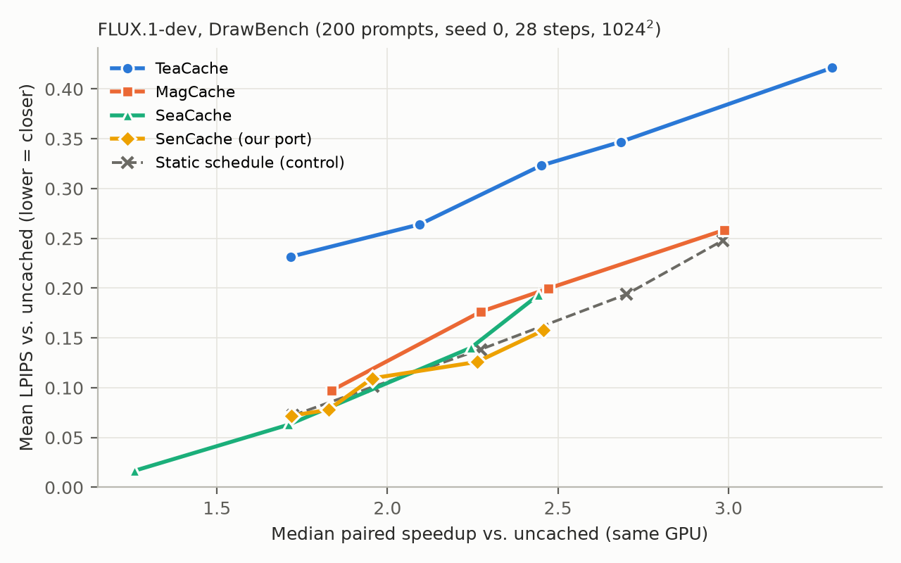
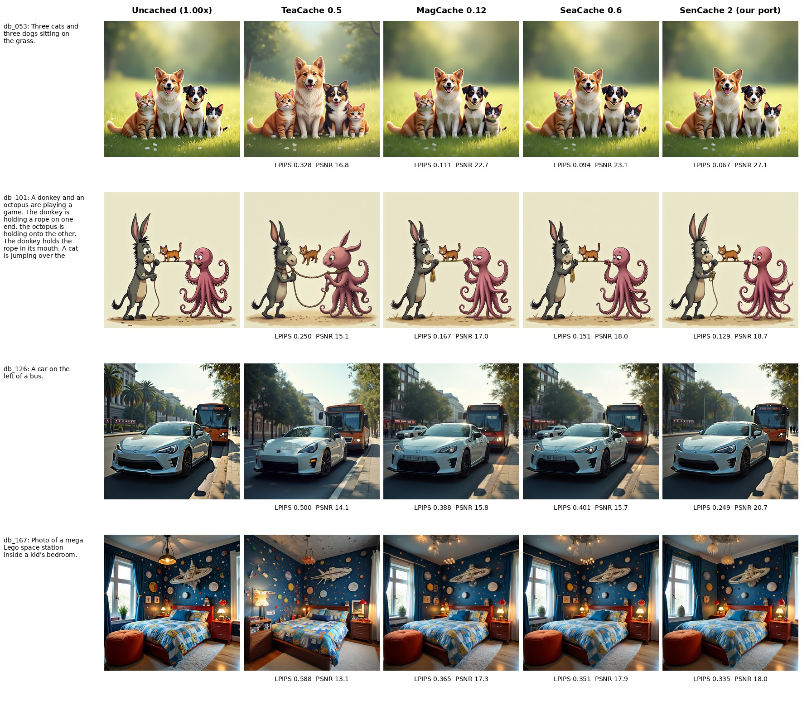

# Text-to-image extension: FLUX.1-dev on DrawBench

## Setup

We carried the comparison from Wan2.1/VBench over to text-to-image generation. The setup is:

- **Generation:** FLUX.1-dev (revision `3de623f`), 1024×1024, 28 FlowMatch-Euler steps, guidance 3.5, BF16.
- **Prompts:** all 200 DrawBench prompts, with seed 0 for every prompt.
- **Software:** one NVIDIA H200, diffusers 0.32.2.

**Shared caching mechanism ("how").** All methods share one compute path. On a reuse step, the whole double- and single-block stack is replaced by `h_in + r`, where `r = h_out − h_in` is the cached residual from the most recent full computation. Only the rule that decides *when* to recompute differs between methods:

- **TeaCache, MagCache, SeaCache:** the rule is the authors' own FLUX code, unchanged.
- **Equivalence check:** on a small random FLUX model, our forward pass produced bit-identical outputs to each upstream forward pass, across 8 thresholds per method.

**SenCache port.** SenCache has no official FLUX implementation, so we ported the decision rule from the authors' Wan2.1 code. We checked it on a stub model: our rule made the same compute/reuse decision as the upstream rule at every step, for 24 threshold combinations. The rule and its settings are:

- **Decision rule:** reuse the cache while `J_z·‖Δz‖ + J_t·|Δt|` stays below the threshold. A stricter threshold (0.045) applies during the first 20% of steps, and at most K = 3 reuses may occur in a row. These values come from the authors' Wan README, since no FLUX values exist.
- **Calibration:** `J_z` and `J_t` were measured with the authors' finite-difference procedure on 64 real images from DOCCI, which do not overlap DrawBench. The per-image values were averaged arithmetically.
- **Threshold scaling:** the threshold is multiplied by `sqrt(numel(z))`. The constant hard-coded upstream (1447.98) equals `sqrt(numel)` of the Wan latent, so this is the same scaling applied to the FLUX latent size (factor 512).
- **Threshold choice:** the threshold-to-speed relationship was mapped on 16 held-out DOCCI captions before any DrawBench run.

**Static-schedule control.** We added a prompt-independent schedule of our own design, which is not a published method. It computes the first 6 steps (20%, the same as SenCache's strict phase), then spreads the remaining refreshes evenly and always computes the final step.

**Metrics.** We report two groups of metrics, which answer different questions:

- **Fidelity** (PSNR, SSIM, LPIPS): how close each image is to the uncached image for the same prompt and seed.
- **Quality** (CLIP score with ViT-L/14, ImageReward v1.0): how well the image matches the prompt and how good it looks.

Speedup is the median over prompts of `t_uncached / t_cached`, measured end to end (text encoding through VAE decoding) on the same GPU. We re-ran the uncached reference, and it reproduced all 200 images bit-exactly, with a median time ratio of 0.9999. Every configuration used about 33.9 GiB of peak memory, so memory does not separate the methods.

Thresholds were chosen only to land on shared speed budgets: the initial grids came from the method defaults and the DOCCI pilot, and later fill-in points were interpolated from measured speedups. None were tuned for quality on DrawBench. Comparisons are made at matched speedup, never at matched threshold. Thresholds are not comparable across methods.

## Results

| Budget | Config (speedup) | PSNR ↑ | SSIM ↑ | LPIPS ↓ | CLIP | ImageReward |
|---|---|---|---|---|---|---|
| — | Uncached (1.00×, 6.51 s) | — | — | — | 27.55 | 1.030 |
| ~1.7× | SeaCache 0.3 (1.71×) | **29.43** | **0.930** | **0.063** | 27.62 | 1.008 |
| | SenCache 0.5 (1.72×) | 28.31 | 0.920 | 0.072 | 27.56 | 1.025 |
| | Static, 16 steps (1.72×) | 28.19 | 0.920 | 0.072 | 27.59 | 1.023 |
| | TeaCache 0.25 (1.72×) | 19.77 | 0.786 | 0.232 | 27.89 | 1.049 |
| ~1.8× | SenCache 0.6 (1.83×) | **28.04** | **0.916** | **0.078** | 27.60 | 1.025 |
| | MagCache 0.06 (1.84×) | 26.48 | 0.898 | 0.097 | 27.57 | 1.020 |
| ~2.25× | SenCache 1.0 (2.26×) | **25.62** | **0.875** | **0.126** | 27.46 | 1.007 |
| | Static, 12 steps (2.27×) | 24.87 | 0.864 | 0.138 | 27.53 | 1.008 |
| | SeaCache 0.45 (2.25×) | 24.26 | 0.862 | 0.140 | 27.58 | 1.007 |
| | MagCache 0.09 (2.27×) | 22.42 | 0.832 | 0.176 | 27.69 | 1.027 |
| ~2.45× | SenCache 2 (2.46×) | **24.56** | **0.846** | **0.158** | 27.49 | 1.004 |
| | SeaCache 0.6 (2.44×) | 22.25 | 0.822 | 0.193 | 27.78 | 1.014 |
| | MagCache 0.12 (2.47×) | 21.82 | 0.817 | 0.200 | 27.68 | 1.005 |
| | TeaCache 0.5 (2.45×) | 17.97 | 0.727 | 0.323 | 27.78 | 1.017 |
| ~3× | Static, 9 steps (2.98×) | **22.44** | **0.794** | **0.248** | 27.56 | 0.948 |
| | MagCache 0.24 (2.99×) | 20.40 | 0.774 | 0.258 | 27.93 | 0.995 |
| | TeaCache 0.8 (3.30×) | 16.69 | 0.674 | 0.421 | 27.49 | 0.949 |

Four prompts drawn at random (RNG seed 0, not hand-picked) at about 2.45×. TeaCache drifts in layout and identity. MagCache, SeaCache and SenCache keep the uncached composition and differ in fine detail, matching the LPIPS ranking.

Paired LPIPS differences with 95% bootstrap confidence intervals over prompts are in `pairwise_lpips.csv`. Every ranking claimed below has a confidence interval that excludes zero, unless we call it a tie. Complete per-configuration and per-image numbers are in `summary_all.csv` and `per_image_metrics_all.csv`.

## Findings

**1. Fidelity differences between methods are large, but quality metrics barely move.** At matched speed, LPIPS differs by up to 5× between methods. TeaCache is the furthest from uncached at every budget: SeaCache beats it on 100% of prompts at about 1.7×, and SenCache on 97.5% at about 2.45×. Yet CLIP score stays within ±0.4 of uncached for every configuration. ImageReward stays within about 0.03 up to 2.5×, and only begins to fall near 3× (0.95 for both TeaCache 0.8 and Static-9, compared with 1.03 uncached). A cached image can therefore drift a long way from the uncached image while remaining an equally good answer to the prompt. We therefore report fidelity as "deviation from the full computation", not as image quality, and we do not rank methods on CLIP or ImageReward.

**2. The position of refresh steps explains most of the ranking.** The methods' decision rules vary very little with the prompt (`schedules.csv`):

- MagCache produces one identical schedule for all 200 prompts at every threshold.
- SenCache at threshold 2 also produces a single schedule.
- The other configurations produce 1–11 distinct schedules, and the most common schedule covers 27–100% of prompts.

In practice, each method acts as a schedule generator. The best-performing schedules protect the early, high-noise steps:

- **Early steps computed, out of the first 6:** SenCache 6, SeaCache 4–6, MagCache 4–5, TeaCache 2–4. This order matches the fidelity order at every budget.
- **The simple static control** (compute 6 steps, then refresh evenly) beats MagCache at about 2.25× (80% of prompts). It roughly matches MagCache at about 3×, with ΔLPIPS −0.010 and a 95% CI of [−0.019, −0.0015]. It beats TeaCache by a wide margin at every budget.

**3. Adaptive rules help only in specific regimes.** The comparison against static schedules with the same number of steps shows where each decision rule adds value:

- **SeaCache at about 1.7×** is better than the static schedule, with ΔLPIPS −0.009 and a CI that excludes zero.
- **SenCache at about 2.25×** is better than the static schedule on 93.5% of prompts, with ΔLPIPS −0.013. Its refreshes are placed unevenly, following the calibrated sensitivity curve.
- **SenCache at about 1.7×** ties with the static schedule (ΔLPIPS −0.0002, CI includes 0).
- **SenCache at about 1.96×** is slightly worse than the static schedule, though the static schedule computes about 0.6 more steps on average.
- **SeaCache at about 2.25×** ties with the static schedule.

The gain from SenCache therefore comes from a calibrated, timestep-dependent placement that is nearly identical for every prompt. It does not come from adapting to each sample.

**4. SenCache has a speed ceiling under its default rules.** Two rules cap the speedup: every step in the first 20% is computed (in practice no step there passes the strict threshold), and no more than 3 reuses may occur in a row. Together they limit SenCache to 11 of 28 computed steps, about 2.45×. Above a threshold of about 1.2, the schedule stops changing and the method becomes a fixed schedule: the first 6 steps, then every 4th step.

Wan shows the same limit: SenCache's speedup flattens at about 2.47× for thresholds of 1–4. So "best fidelity at 2.45×" describes this fixed schedule, not the sensitivity criterion. SenCache cannot reach the 3× budget without changing K, which would no longer be the authors' setting.

**5. Speedup is set almost entirely by the fraction of refreshed steps.** At a refresh ratio of 0.393, TeaCache, SenCache and MagCache reach 2.45×, 2.46× and 2.47× respectively. SeaCache's spectral filter adds a small overhead. Comparing methods at matched refresh ratio is therefore close to comparing them at matched wall-clock time.

## Limitations

- Single seed per prompt. Close calls are reported as ties, and differences are given as paired win rates with bootstrap confidence intervals.
- The SenCache FLUX version is our own port, including its calibration data, its threshold scaling, and the K and start threshold taken from Wan. It is not an authors' result.
- The static control is one hand-designed schedule, not an optimised one. A better static schedule could close the remaining gaps in finding 3.
- Fidelity is measured against the uncached FLUX output, not against real images or human ratings.
