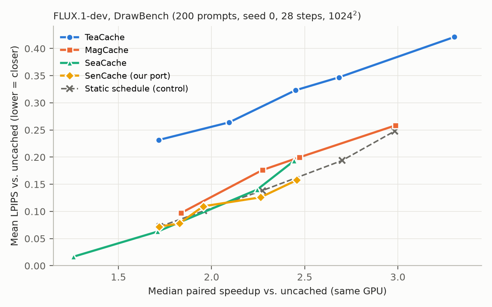
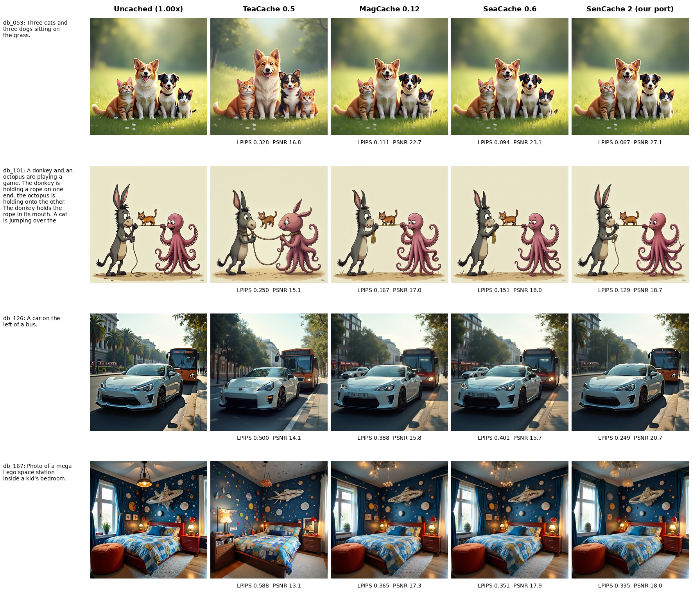

# DrawBench × FLUX.1-dev

## Protocol

We evaluate 200 DrawBench prompts at seed 0 using FLUX.1-dev (revision `3de623fc3c33e44ffbe2bad470d0f45bccf2eb21`), 28 FlowMatch-Euler steps, 1024×1024, guidance 3.5, BF16 and batch size 1 on H200. The 24 configurations comprise Uncached, four cache methods and a fixed-schedule control. Sen-FLUX is our port of the Wan decision rule, calibrated on 64 DOCCI images; it is not an official SenCache FLUX result.

All methods use the shared residual-cache forward. The fixed control computes the first six steps and distributes the remaining computes, including the final step. Sen instead uses a tighter early threshold; its first six computes are observed, not hard-coded.

PSNR/SSIM/LPIPS measure similarity to the paired Uncached output. CLIP and ImageReward are automated quality/alignment proxies. Speedup is the median paired same-GPU time ratio. Timing covers pipeline generation and excludes model loading and PNG saving. Two Uncached batches produced identical images; later configurations use their own batch's timing reference. Threshold grids were selected for speed coverage, not a globally optimal policy.

## Representative operating points

LPIPS is lower when closer to Uncached. Values below are observed means and speedups, not interpolated measurements.

| Approximate budget | Configuration | Speedup | LPIPS |
|---|---|---:|---:|
| 1.7× | Sea 0.3 | 1.71× | 0.06286 |
| | Sen 0.5 | 1.72× | 0.07201 |
| | Fixed 16 | 1.72× | 0.07216 |
| | Tea 0.25 | 1.72× | 0.23170 |
| 2.25× | Sen 1.0 | 2.26× | 0.12593 |
| | Fixed 12 | 2.27× | 0.13845 |
| | Sea 0.45 | 2.25× | 0.14015 |
| | Mag 0.09 | 2.27× | 0.17627 |
| 2.45× | Sen 2 | 2.46× | 0.15758 |
| | Sea 0.6 | 2.44× | 0.19301 |
| | Mag 0.12 | 2.47× | 0.19960 |
| | Tea 0.5 | 2.45× | 0.32311 |
| 3.0× | Fixed 9 | 2.98× | 0.24801 |
| | Mag 0.24 | 2.99× | 0.25835 |

Tea 0.8 reaches 3.30×/0.42134 LPIPS, a different budget. Sea/Sen have no measured 3× point in this grid.

## Findings

1. **The preferred method depends on the budget.** Sea has the lowest mean LPIPS among the displayed 1.7× points; Sen has the lowest at approximately 2.25× and 2.45×. These results do not establish universal superiority over Tea/Mag or across metrics/tasks.
2. **Computation count is insufficient.** Tea/Mag/Sen at approximately 2.45× all compute eleven stages but differ substantially in LPIPS. Schedule placement is a plausible mechanism; this observational comparison does not isolate its causal effect.
3. **Adaptation adds value in some regimes.** Sen 1.0 improves mean LPIPS over Fixed 12 by about 0.0125, winning on 93.5% of paired prompts. Sen 0.5 and Fixed 16 are not separated by the reported paired interval. At about 1.96×, Fixed 14 has better LPIPS/SSIM than Sen 0.8, while PSNR favors Sen. The control is one designed schedule, not the best possible static policy.
4. **The high-threshold Sen batch is cap-controlled.** All 200 threshold-2 records share one schedule. A read-only audit attributes every post-prefix refresh to K=3 and proves a conditional schedule-preserving threshold interval. The eleven computes attain the count minimum conditional on the observed six-compute prefix. This is not a universal 2.45× ceiling, nor evidence from an unmeasured threshold-1.2 run. See [proof](../../report/sen_plateau_proof.md).
5. **Fidelity and task quality answer different questions.** CLIP/ImageReward do not follow the LPIPS ranking consistently. Similar proxy averages do not establish equal human-perceived quality. The uncached reference can itself miss object counts or prompt relations.

The four prompts were selected by RNG seed 0. They illustrate deviations from the reference; each case must also be checked against its text prompt. The original PNGs in the separate supplement support closer inspection.

## Wan comparison and limitations

The final Wan test is a 110-prompt VBench subset, with 550 primary videos per method on A100. Its LPIPS/speed pairs are Sea 0.0482/1.49×, Mag 0.0873/1.58×, Sen 0.1423/1.65× and Tea 0.1464/1.58×. These thresholds target at least 2× denoising speed on development data; they are not an exactly matched end-to-end budget. Wan's larger retained runtime prevents direct speed comparison with FLUX.

`results/wan_schedules/schedules_wan.csv` is a historical 183-run sample, not the final complete Wan audit. Do not use it to claim that all Wan schedules are prompt-independent, or that K alone explains seventeen computes. No Wan fixed-schedule control was run.

DrawBench uses one seed. Paired bootstrap intervals describe this prompt set and are exploratory across many comparisons. Original Sen per-image records omit runtime binding of K, early threshold and profile hash; the supplement supplies retrospective provenance. The existing aggregate CSVs remain unchanged. Some rows of `pairwise_lpips.csv` have different speeds (e.g. Fixed 10 vs Mag 0.24); read both speed columns before calling them matched-budget comparisons.
